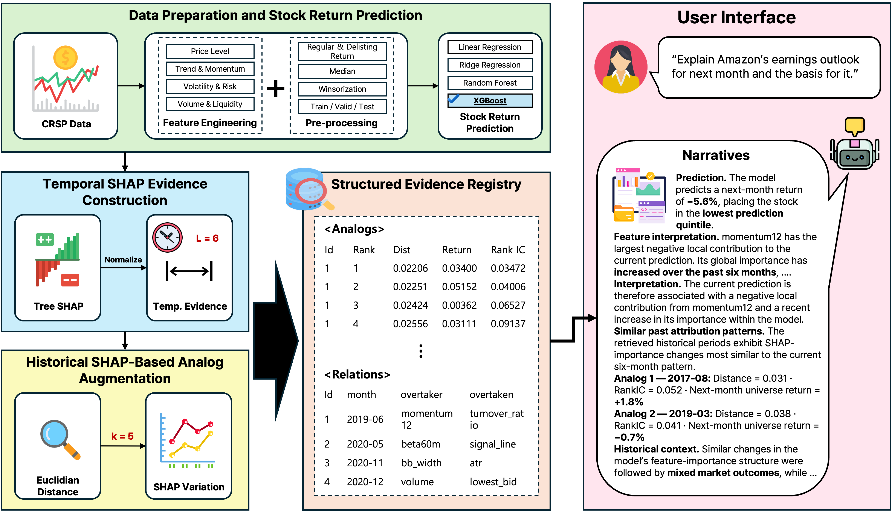

# LLM4XAI

**Reasoning Externalization for Faithful Large Language Model Narratives of Stock Return Predictions**  
Sujung Kim · Seung Hwan Cho · Sangjin Park · Young-Min Kim  
LLM4XAI Workshop, CIKM 2026

LLM4XAI generates and evaluates evidence-grounded explanations of stock return predictions. Changes, trends, and feature-importance order reversals are computed before the LLM generates its narrative.

[Method](#method) · [Results](#experimental-results) · [Setup](#environment-setup) · [Usage](#usage) · [Data](#data-and-release-scope)

## Key Features

- **Reasoning externalization:** Five conditions, from current SHAP evidence to precomputed temporal statistics, relations, and historical analogs.
- **Historical context:** Five past periods retrieved by similarity in SHAP importance changes.
- **Evidence verification:** DuckDB records linked to structured claims through evidence IDs.
- **PERMNO question answering:** C3-Analog explanations for stock-month pairs stored in the database.

## Method

[](assets/framework.png)

*Framework overview from the final presentation (slide 7).*

1. **Load inputs:** Next-month return predictions from a fixed XGBoost model, local SHAP values, and monthly global importance for 30 features.
2. **Compute temporal evidence:** Normalize monthly mean absolute SHAP values; compute changes, OLS trends, and importance-order reversals over six observations.
3. **Retrieve historical analogs:** Compare 180-dimensional vectors of six monthly importance changes across 30 features using Euclidean distance. Use a six-month window and five analogs, based on empirical comparisons of retrieval configurations.
4. **Store and generate:** Organize evidence in DuckDB and supply condition-specific records to the LLM.
5. **Verify claims:** Check structured factual fields and citations against the supplied evidence.

**Retrieval rules.** Six monthly changes require seven importance observations. For current month `t`, a historical endpoint `s` must satisfy `s <= t - 7`; all seven supporting months must be in the configured test period. Candidates are considered in distance order, with at least six months between selected endpoints. A case is eligible only when five analogs are available. Historical RankIC and subsequent equal-weight universe returns provide comparative context.

| Condition | Evidence supplied to the LLM |
|---|---|
| C0-Evidence Control | Prediction, feature values, local SHAP, and current global importance |
| C1-Raw | C0 + six-month global importance sequences |
| C2-Numerical | C1 + precomputed changes, slopes, and trends |
| C3-Relational | C2 + importance-order reversals (`OVERTAKES`) |
| C3-Analog | C3 + historical analogs and summary statistics |

## Experimental Results

The controlled experiment uses 480 cases across 96 months, with one stock sampled per prediction quintile each month: 2,400 outputs per model across five conditions.

| Qwen3-32B comparison | Metric | Reported result |
|---|---|---|
| C1 → C2 | Temporal accuracy | 0.3396 → 0.9896 |
| C2 → C3 | Relational accuracy | 0.5729 → 1.0000 |
| C1 → C3 | Evidence Faithfulness (EF) | 0.6960 → 0.9964 |

C3-Analog obtains EF of 0.9891, compared with 0.9964 for C3. In the paper's user study, ten evaluators each rated four narratives, covering C3-Relational and C3-Analog on five-point scales. The average ratings were 3.16 and 3.62, respectively.

<details>
<summary>Evaluation metrics</summary>

- **EF:** Mean per-narrative fraction of supported factual claims.
- **Temporal accuracy:** Correct trend for the feature with the largest absolute local SHAP value. C0 evaluates abstention separately.
- **Relational accuracy:** At least one true reversal and no false relations when reversals exist; no relation claims otherwise. C0 is excluded.
- **Parse rate:** Parsing and schema-validation success after up to two format-repair attempts. Content metrics use successfully parsed outputs.
- **Statistical comparison:** Paired month-cluster bootstrap with Holm adjustment.

</details>

## Environment Setup

Validated environment: Linux, Python 3.12, CUDA, and vLLM 0.11.2. Run commands from the repository root.

```bash
pip install -r requirements.txt
export LLM4XAI_INPUT_ROOT=/path/to/private/inputs
export LLM4XAI_OUTPUT_ROOT=/path/to/private/outputs
```

Obtain model weights separately. Set the model's GPU in `config/settings.yaml` (`cuda_visible_devices` and `expected_gpu_name_contains`). Set `EXP_PYTHON` for a specific Python executable, or `LLM4XAI_DB_PATH` for an existing evidence database.

## Usage

### Controlled Experiments

```bash
bash scripts/run.sh build --seed 42
bash scripts/run.sh prompts --seed 42
CUDA_VISIBLE_DEVICES=0 bash scripts/run.sh generate --role primary --seed 42
bash scripts/run.sh evaluate --role primary --seed 42
bash scripts/run.sh statistics --role primary --seed 42
bash scripts/run.sh export
```


<details>
<summary>Model roles</summary>

| Role | Model |
|---|---|
| `primary` | Qwen3-32B |
| `robustness` | Qwen3-14B |
| `qwen3_8b` | Qwen3-8B |
| `qwen3_8b_base` | Qwen3-8B-Base |
| `qwen3_14b_base` | Qwen3-14B-Base |
| `ministral_8b` | Ministral-8B-Instruct-2410 |
| `llama3_8b_official` | Llama-3.1-8B-Instruct |

</details>

### PERMNO Question Answering

Start the program from the repository root:

```bash
CUDA_VISIBLE_DEVICES=0 bash scripts/run.sh ask
```

When `질문:` appears, enter a question containing the PERMNO and basis month:

```text
For PERMNO 38850, as of 2020-08, explain the next-month return prediction and its evidence, including historical analogs.
```

Question → PERMNO/month lookup → parameterized SQL → C3-Analog evidence → answer generation and verification.

<details>
<summary>Explicit options for scripted execution</summary>

Alternatively, supply the question and selection as command-line options:

```bash
CUDA_VISIBLE_DEVICES=0 bash scripts/run.sh ask --role primary \
  --permno 38850 --month 2020-08 --language en \
  --question "Explain the next-month return prediction and its evidence, including historical analogs."
```

</details>

## Data and Release Scope

The study uses 30 characteristics from monthly CRSP observations, with training in 1995–2009, validation in 2010–2011, and testing in 2012-01–2023-11. Input features must already have missing values handled; the code applies training-based 1st/99th percentile clipping and mean/std scaling.


<details>
<summary>Required private inputs</summary>

| File | Required columns |
|---|---|
| `panel31_newprepro_nannormal_fixbidask.parquet` | `PERMNO`, `date`, `next_month_ret_original`, and the configured 30 features |
| `shap_local_test_seed42.parquet` | `PERMNO`, `month`, `pred`, `y`, and per-feature `phi_*` |
| `monthly_state_seed42.parquet` | `month`, `split`, `n_stocks`, and per-feature `A_*` and `P_*` |
| `monthly_ic_seed42.parquet` | `month`, `split`, `IC` |

`month` uses `YYYY-MM`. `A_*` denotes mean absolute SHAP, `P_*` normalized importance, and `IC` monthly RankIC. Inputs must share the same fixed predictor, feature order, and periods. File names are configured in `config/settings.yaml`.

</details>

## Repository Structure

```text
LLM4XAI/
├── assets/        # Workflow figure
├── config/        # Settings, feature metadata, output schema (3 files)
├── prompts/       # Experiment and question-answering instructions
├── scripts/       # Command entry point
├── src/           # Data, evidence, generation, and evaluation (12 modules)
├── requirements.txt
└── README.md
```


## About

Sujung Kim, Seung Hwan Cho, Sangjin Park, and Young-Min Kim (2026). *Reasoning Externalization for Faithful Large Language Model Narratives of Stock Return Predictions*. LLM4XAI Workshop, CIKM 2026.

Contact: sujung2026@hanyang.ac.kr  
